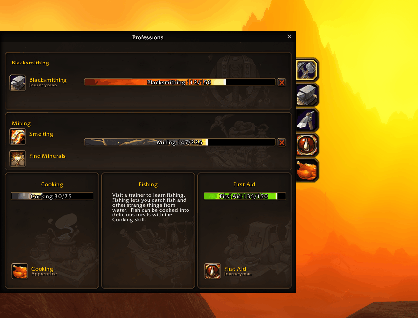
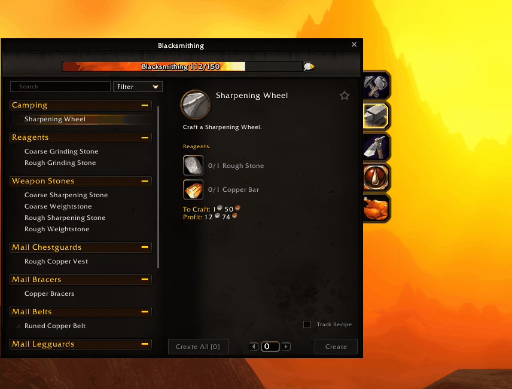

# Profession Hints Forever

Open Professions in WoW Forever and hover over a skill bar to see what to craft or gather next, where to gather and where to train when you hit a cap. It also works in the crafting window and covers all 12 professions from 1 to 300.

This is a work in progress. If you find a better recipe, skill breakpoint, gathering zone, or trainer location, [help improve a route](#contribute-a-route).

## In-game demos

**Professions overview**: Hover over a skill bar on the main Professions page.



**Crafting windows**: Hover over the skill bar inside a profession’s own window.



## Install

Extract the `ProfessionHintsForever` folder into `World of Warcraft/_forever_/Interface/AddOns`, so `ProfessionHintsForever.toc` is directly inside the addon folder. Enable **Profession Hints Forever** in WoW and open Professions.

Mining shows a node, a skill target, and up to three zones. When smelting can grant skill, you also see a recommended bar to make and its own target. Smelt Iron can take you to 140, then mine to 155 to learn Smelt Gold. Gold can take you to 185. Switch back to mining for regular skill-ups from 185. Smelting targets are recommendations and can require multiple crafts per point.

Herbalism, Skinning, and Fishing show what to gather, your next skill target and nearby zones. You can level Fishing in starter waters. At a skill cap, the tooltip gives a trainer, book vendor, or quest destination for your faction and includes the district or settlement where available.

Crafting shows a recommended recipe and an alternative where available. In your crafting window, the addon flags a recipe when the game reports that you haven't learned it. The tooltip uses a verified location or the game's own source text when available. It checks recipe status by name against the bundled English route.

## Zone order

Gathering tooltips sort suitable zones nearest first using straight-line distance to the zone center. Your current zone comes first if it fits the bracket. Zones on other continents or without coordinates follow the measurable ones in bundled order. If your position is unavailable, the tooltip uses the bundled order.

## Contribute a route

Small updates are welcome. You can change a single recipe, add a gathering zone, or correct a vendor or trainer location.

1. Open [Routes.lua](Routes.lua) on GitHub, click the pencil icon, and follow the prompts to fork the repo. You can make the edit in your browser.
2. Find the profession by its name in the comments under `addon.routes`. Edit an existing row or insert a row to add a new breakpoint. Keep rows in ascending skill order. The first number is the skill at which the hint starts. The next row sets the switch point, and the last row targets 300.
3. Click **Propose changes** and open a pull request against `main`. Follow the [pull request template](.github/pull_request_template.md).

### Pull request format

- **Problem** — Describe what is wrong or missing. For route changes, include the profession and affected skill range.
- **Solution** — Describe what you changed. Link to a WoW Forever source if it supports the change.
- **In-game testing proof (if required)** — For changes that affect what players see in game, describe what you tested and attach a screenshot or short clip. If you couldn't test in game, say so. For changes that don't affect the game, enter `N/A`.

### Route examples

These two Alchemy rows recommend Lesser Mana Potion at 120 and switch to Mana Potion at 160. Use the exact English recipe name so the crafting window can match it.

```lua
{ 120, "Lesser Mana Potion" },
{ 160, "Mana Potion" },
```

To suggest a gathering zone, edit the `zones` list for the relevant row. Use the zone names defined as Lua variables at the top of the file.

```lua
{ 65, "Tin Vein", zones = { redridge, ashenvale, barrens, loch, wetlands } },
```

Recipe locations live in `addon.recipeSources`. Rank-cap destinations live in `addon.training`, where you can set separate locations for Alliance and Horde. For recipe changes, check that the recipe can be learned by the starting skill and can still give skill-ups through the bracket.

### Test in WoW Forever

Copy `ProfessionHintsForever.toc`, `Routes.lua`, and `ProfessionHintsForever.lua` from your edited branch into `_forever_/Interface/AddOns/ProfessionHintsForever`. In game, run `/reload` and hover over the profession skill bar. If you have a character near a changed breakpoint, check both sides of the switch. For recipe changes, also check the profession's own crafting window.

You can also [open an issue](https://github.com/Ruben03x/professionhints-forever/issues/new) with the profession, your skill level, the current hint, and what you expected to see.

## Data sources

Routes checked against WoW Forever build 1.60.1.71091 and Forever guides on November 25, 2026. Trainer stock and quest availability can change server-side. The recommendations and destination hints live in `Routes.lua`.

- Blacksmithing follows [Wowhead's Tried & Tested in Forever route](https://www.wowhead.com/forever/profession-leveling-guides/blacksmithing).
- Recipe skill requirements and skill-up ranges were checked against [Bind on Forever](https://bindonforever.com/professions) and the [WoW Forever recipe database](https://wow-forever.gg/professions/). [Wowhead's Enchanting guide](https://www.wowhead.com/forever/guide/professions/enchanting/overview) lists the rod breakpoints.

- Mining brackets and zone ordering draw from [Wowhead's Forever Mining guide](https://www.wowhead.com/forever/guide/professions/mining/overview-leveling), [its Iron Deposit data](https://www.wowhead.com/forever/object=1735/iron-deposit), and [Method's Forever zone guide](https://www.method.gg/wow-forever/mining-and-ore-farming-routes-in-wow-forever-best-mithril-thorium-and-heavy-thorium-farming-routes). Smelting targets follow Wowhead and [Method's Mining leveling guide](https://www.method.gg/wow-forever/mining-in-wow-forever-leveling-guide-mining-items-enchants-trainers).
- The Herbalism, Skinning, Fishing, and early crafting recommendations draw from [Icy Veins' Forever profession guides](https://www.icy-veins.com/wow-forever/). First Aid uses [Wowhead's bandage route](https://www.wowhead.com/forever/guide/professions/first-aid/overview).
- [ForeverArtisan's leveling guides](https://foreverartisan.app/guides/) cover Engineering and supplement Alchemy, Leatherworking, and Tailoring after 225. [Hardcore Helper's Forever guides](https://www.hardcorehelper.com/forever/guides) cover Enchanting.
- Rank destinations draw from [WoW Professions' Forever trainer guides](https://www.wow-professions.com/forever), [Warcraft Tavern's Forever trainer guide](https://www.warcrafttavern.com/forever/guides/profession-trainers/), and [Wowhead's Forever Fishing guide](https://www.wowhead.com/forever/guide/professions/fishing/overview-leveling).
- Recipe destinations draw from Forever entry data at [Bind on Forever](https://bindonforever.com/professions), [ForeverDB](https://www.foreverdb.app/), and [Azeroth Wiki](https://azeroth.wiki/forever/).

## License

The original addon code and build scripts are [MIT licensed](LICENSE). See the [scope and credits](NOTICE).
